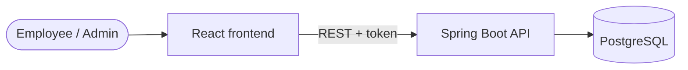

<p align="center">
  
</p>

<p align="center">
  
  
  
  
  
  
</p>

<p align="center">
  <a href="#-features">Features</a> ·
  <a href="#-getting-started">Getting started</a> ·
  <a href="#-demo-accounts">Demo accounts</a> ·
  <a href="#-api-overview">API</a> ·
  <a href="#-team">Team</a>
</p>

---

## 💡 About

Small companies often have no IT department. Problems arrive as scattered messages, and when the wifi goes down, twelve people report the same thing and twelve separate tickets pile up.

This platform turns scattered reports into **one clear picture**: similar tickets are grouped into a single incident ("12 people affected, 2nd floor"), every ticket has a deadline that counts down, and every change is recorded.

Built during a one-day hackathon. All demo data is fake.

## ✨ Features

<table>
  <tr>
    <td width="33%" valign="top">
      <h3>🎫 Ticketing</h3>
      Create, list and update tickets with status, priority and assignee.
    </td>
    <td width="33%" valign="top">
      <h3>🧩 Incident clustering</h3>
      Similar tickets are grouped into one incident with an affected count.
    </td>
    <td width="33%" valign="top">
      <h3>⏱️ SLA timers</h3>
      Deadlines by priority, shown as a countdown that turns orange, then red.
    </td>
  </tr>
  <tr>
    <td width="33%" valign="top">
      <h3>🕓 History timeline</h3>
      Every change to a ticket is recorded and shown as a timeline.
    </td>
    <td width="33%" valign="top">
      <h3>📊 Admin dashboard</h3>
      Live view of incidents, tickets and SLA status in one place.
    </td>
    <td width="33%" valign="top">
      <h3>🔐 Roles</h3>
      Login with two roles: <code>EMPLOYEE</code> and <code>ADMIN</code>.
    </td>
  </tr>
</table>

## 🧰 Tech stack

| Layer | Technology |
|---|---|
| Backend | Java 21, Spring Boot, Spring Data JPA, MapStruct, Lombok |
| Frontend | React with Vite (TypeScript, kept simple) |
| Database | PostgreSQL |
| Tooling | Gradle, Docker Compose, pgAdmin |

## 🏗️ Architecture



The backend is one Spring Boot application split into feature modules:

| Module | Responsibility |
|---|---|
| `user` | Login, roles and users |
| `ticket` | Creating and updating tickets |
| `incident` | Grouping tickets into incidents |
| `sla` | Deadlines and timers |
| `audit` | Change history |
| `config` | CORS, authentication filter, shared configuration |

## 🚀 Getting started

**Prerequisites:** Java 21, Node.js 20 or newer, Docker Desktop.

### 1. Clone and configure

```bash
git clone https://github.com/Malick-Konate/hackathon-2026.git
cd hackathon-2026
cp .env.example .env        # optional: change the values in .env
```

### 2. Start the database

```bash
docker compose up -d        # starts PostgreSQL (db) and pgAdmin, not the app
```

| Service | What it is | URL / port |
|---|---|---|
| `db` | PostgreSQL 16 | `localhost:5434`, database `ItHelpDesk` |
| `pgadmin` | Web UI to browse the database | http://localhost:9000 |
| `app` | The Spring Boot app in a container (optional) | http://localhost:8080 |

In pgAdmin, add a server with host `db` and port `5432`. The credentials are in `docker-compose.yml`.

### 3. Run the backend

**While developing:** run `ItHelpDeskApplication` in IntelliJ, or from the repo root:

```bash
./gradlew :backend:bootRun          # Windows: gradlew.bat :backend:bootRun
```

**For the demo (everything in Docker):**

```bash
docker compose --profile app up -d --build
```

Stop the IntelliJ run first, because both use port 8080. The API runs on http://localhost:8080.

Run the tests (in-memory H2 database, no Docker needed):

```bash
./gradlew :backend:test
```

### 4. Run the frontend

```bash
cd frontend
npm install
npm run dev
```

The app runs on http://localhost:5173.

> 💡 If you change the database schema, recreate the database with `docker compose down -v` and start it again.

## 👤 Demo accounts

| Role | Email | Password |
|---|---|---|
| Admin | `Christine@demo.com` | `pwd` |
| Employee | `Bahman@demo.com` | `pwd` |
| Employee | `Amin@demo.com` | `pwd` |

## 🔌 API overview

All endpoints except login need the header `Authorization: Bearer <token>`.

| Method | Path | Purpose |
|---|---|---|
| `POST` | `/api/auth/login` | Log in, returns a token and the user |
| `GET` | `/api/auth/me` | Current user |
| `POST` | `/api/auth/logout` | Log out |
| `GET`, `POST` | `/api/tickets` | List and create tickets |
| `PATCH` | `/api/tickets/{id}` | Update status or assignee |
| `GET` | `/api/incidents` | Incidents with affected counts |
| `GET` | `/api/tickets/{id}/history` | Ticket timeline |

<details>
<summary>Example: log in with curl</summary>

```bash
curl -X POST http://localhost:8080/api/auth/login \
  -H "Content-Type: application/json" \
  -d '{"email":"admin@demo.com","password":"pwd"}'
```

</details>

## 📁 Project structure

```
.
├── backend/              Spring Boot API (Java 21)
│   └── src/main/java/com/konate/ithelpdesk/
│       ├── user/         login and users
│       ├── ticket/       tickets
│       ├── incident/     incident clustering
│       ├── sla/          deadlines and timers
│       ├── audit/        change history
│       └── config/       CORS, auth filter
├── frontend/             React app (Vite + TypeScript)
├── docs/                 banner, logo and screenshots
├── settings.gradle       Gradle root, includes backend/
├── gradlew               Gradle wrapper (run from the repo root)
├── Dockerfile            builds the backend into an image
├── docker-compose.yml    PostgreSQL, pgAdmin and the app
├── .env.example          copy to .env for local settings
└── README.md
```

## 🤝 Team workflow

- `main` always runs. Don't push broken code to it.
- One feature per branch: `feature/<name>`, then a pull request with one review.
- Pull from `main` before starting new work.
- Never commit passwords or API keys. Use environment variables or a local `.env` file.

## 👥 Team
 
**Malick Konate**, **Ilian Adeleke**, **Arushi Naik** and **Jacky Bolap**.
 
---

<p align="center">

  <p></p>
  <p align="center">Built in one day at <b>HackDécouverte 2026</b> 🚀</p>
</p>
